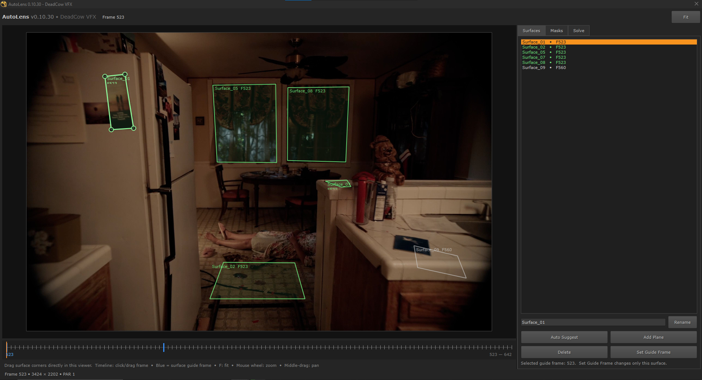
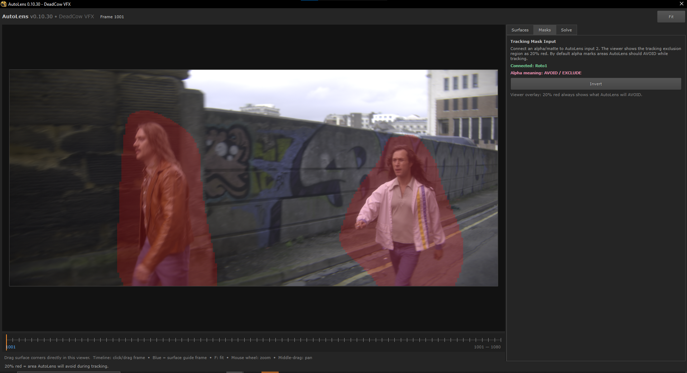
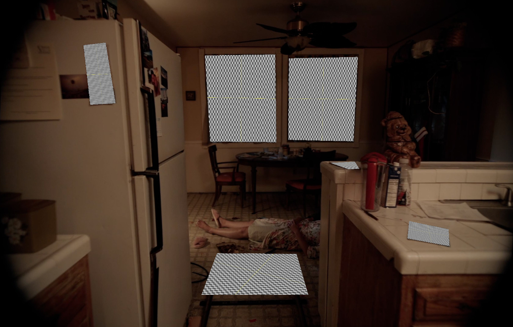

# AutoLens for Nuke

**AutoLens** is an experimental NukeX tool developed by **DeadCow VFX** for estimating lens distortion, solving camera motion, reconstructing rough scene geometry, and building artist-friendly projection surfaces directly from production image sequences — without requiring a photographed lens grid.

Current build: **v0.11.0**


> **Current focus:** practical VFX reconstruction inside Nuke — solving the lens and camera, building rough spatial context, masking unreliable tracking regions, and turning artist-drawn 2D guides into usable 3D projection surfaces.
> AutoLens is intended as a practical VFX utility for shots where camera solve, undistortion, set reconstruction, projection geometry, and artist-guided scene understanding all need to be derived from the photography itself.

---

## Visual Overview

### Guided surfaces directly in the AutoLens viewer

AutoLens lets the artist define planar surfaces directly over the plate. Each surface can have its **own guide frame**, which is useful when a camera move reveals different parts of the environment at different times.



**Green** surfaces are being viewed on their assigned guide frame. Surfaces authored on another frame fade to **gray/white**, while blue timeline markers show where guide frames exist throughout the shot.

### Camera-tracking masks

Moving actors, vehicles, reflections, or other foreground motion can contaminate a reconstruction. AutoLens accepts an external alpha matte and previews the area excluded from feature tracking directly in the workspace.



The translucent red overlay represents the region AutoLens will avoid during tracking. The mask interpretation can be inverted when the matte instead represents the area that should be tracked.

### From 2D guides to usable projection geometry

The purpose of the reconstruction is not simply to produce a point cloud. AutoLens uses the solved camera, sparse 3D observations, dense proxy geometry, and artist guides to generate practical planar geometry for compositing and projection work.



These surfaces can be created individually from the AutoLens node and exported as OBJ geometry with planar 0–1 UVs, making them immediately useful for paint projection, cleanup, set extensions, texture replacement, and CG integration.

---

## What AutoLens Does

AutoLens combines:

- automatic lens-distortion estimation
- sparse feature extraction and matching
- global/incremental Structure-from-Motion
- bundle adjustment
- dense PatchMatch stereo on strategically selected frames
- dense fusion and proxy-mesh generation
- automatic cleanup of bad spanning triangles
- plane extraction / mesh-fit surfaces
- artist-authored guided surfaces
- per-surface guide frames
- Nuke Camera2 export
- Nuke LensDistortion2 undistort/redistort setup
- mask-driven feature rejection
- cached/resumable processing
- versioned solves (`v1`, `v2`, `v3`, ...)
- background solving
- a Mocha-style interactive workspace and timeline

The core idea is to turn a moving image sequence into a useful **VFX scene package**, rather than stopping at a camera track.

---

## The Problem AutoLens Solves

Traditional VFX tracking workflows often separate several tasks:

1. solve the camera
2. estimate or manually derive lens distortion
3. build rough geometry
4. define projection surfaces
5. manually align geometry to the solve
6. manage undistort/redistort
7. keep the shot setup organized in Nuke

This works, but it creates repeated setup work and often leaves artists with a technically solved camera but very little useful spatial context.

AutoLens tries to solve the broader problem:

> **Given only the photographed shot, build the distortion model, camera, rough 3D scene context, and editable projection surfaces needed to start compositing.**

This is particularly useful for:

- set extensions
- cleanup and paint projection
- object removal
- CG integration
- signage or screen replacement
- atmospheric depth placement
- spatially accurate relighting or projections
- difficult handheld or lens-distorted photography
- shots with no lens grid
- productions where the VFX team receives only final photography

---

## High-Level Workflow

```text
DISTORTED SOURCE
      ↓
Feature Extraction / Matching
      ↓
Sparse SfM Camera Solve
      ↓
Bundle Adjustment
      ↓
Lens Model Estimation
      ↓
Smart Dense Reference Selection
      ↓
PatchMatch Stereo
      ↓
Dense Fusion
      ↓
Cleaned Proxy Mesh
      ↓
Automatic Plane Extraction
      ↓
Artist Guided Surfaces
      ↓
Nuke Camera + Lens Setup + Geometry
      ↓
UNDISTORTED VFX WORKING SPACE
      ↓
REDISTORT
      ↓
DISTORTED DELIVERY
```

The intended Nuke workflow is:

```text
DISTORTED SOURCE
      ↓
AUTOLENS_UNDISTORT
      ↓
TRACK / PAINT / PROJECTION / CG / COMP
      ↓
AUTOLENS_REDISTORT
      ↓
DELIVERY
```

---

## Why This Method Is Useful

### 1. No Lens Grid Required

AutoLens estimates distortion from the shot itself using shared camera intrinsics across the sequence.

This is useful when:

- the lens grid was never shot
- the production metadata is incomplete
- the VFX team receives footage after photography
- the camera package changed during production
- the lens cannot be identified confidently

It does **not** replace a properly photographed lens grid in every situation, but it provides a strong reconstruction-driven fallback.

### 2. Camera and Lens Are Solved Together

Instead of treating camera tracking and distortion as isolated tasks, AutoLens uses the relationship between:

- repeated image features
- camera movement
- shared intrinsics
- scene geometry

to estimate a consistent shot model.

### 3. Dense Reconstruction Produces Spatial Context

A normal camera solve gives you points and a camera.

AutoLens additionally creates a rough proxy scene that can help answer:

- where is the floor?
- where are walls?
- where are major set objects?
- what surfaces are in front of or behind each other?
- where can a projection card reasonably live?

### 4. Guided Surfaces Convert Artist Intent Into 3D

Photogrammetry meshes are messy.

AutoLens therefore lets the artist draw simple 2D planar guides in the image and converts those into solved 3D surfaces using:

1. sparse observations inside the guide
2. robust plane fitting
3. proxy/depth evidence as secondary support
4. solved camera rays
5. per-surface guide frames

This means the artist can say:

> "This is the counter."

or:

> "This is the wall visible later in the camera move."

and AutoLens turns that 2D instruction into usable 3D geometry.

### 5. Different Surfaces Can Use Different Frames

As of v0.10.30, every surface has its own guide frame.

Example:

```text
Surface_01 → frame 523
Surface_02 → frame 523
Surface_03 → frame 579
Surface_04 → frame 612
```

This matters when the camera pans, reveals new geometry, or sees opposite sides of a room at different times.

The solver chooses the corresponding solved camera pose and sparse observations for each surface independently.

### 6. Resumable and Versioned

Long solves are expensive.

AutoLens caches major stages so the artist can reuse:

- extracted features
- matches
- sparse reconstruction
- dense workspace
- proxy mesh
- guide fitting data

A shot can also contain:

```text
AutoLens/
    v1/
    v2/
    v3/
```

The Nuke node detects versions and allows switching between them.

---

# Installation

## Recommended

Download `AutoLens_NukeX_vX.Y.Z.zip` from the
[latest GitHub Release](https://github.com/iconnorthomas/AutoLens/releases/latest), unzip it, and
run:

```text
install_autolens.bat
```

or:

```bash
python install_autolens.py
```

AutoLens installs into:

```text
~/.nuke/AutoLens
```

and adds itself to Nuke's plugin path.

The installer preserves managed runtime environments between updates:

```text
.venv
.miniforge3
.colmap_env
.managed_colmap
```

---

# Managed COLMAP Backend

AutoLens currently uses a managed Miniforge/Conda environment.

Typical locations:

```text
~/.nuke/AutoLens/.miniforge3
~/.nuke/AutoLens/.colmap_env
~/.nuke/AutoLens/.managed_colmap/launcher.json
```

The managed backend is preferred over relying on a random system COLMAP install because AutoLens can control:

- package version
- CUDA-capable builds
- PyCOLMAP compatibility
- command-line behavior
- reproducibility across machines

Current tested managed backend:

```text
COLMAP / PyCOLMAP 4.2.0
```

---

# Reconstruction Pipeline

## Feature Extraction

AutoLens runs COLMAP feature extraction with a shared camera model.

Current lens model:

```text
RADIAL
```

Parameters:

```text
f
cx
cy
k1
k2
```

Distortion model:

```text
scale = 1 + k1*r² + k2*r⁴
```

The shot is treated as a single camera unless the workflow is deliberately changed.

---

## Matching

Feature matching establishes correspondence between frames.

GPU acceleration is used where the installed COLMAP build supports it.

---

## Sparse Reconstruction

AutoLens can use incremental and/or global reconstruction.

In practice, global SfM has proven particularly useful when incremental reconstruction fails to connect the full shot.

Sparse output provides:

- registered camera poses
- sparse 3D points
- feature tracks
- reprojection errors
- shared camera intrinsics

---

## Bundle Adjustment

Bundle adjustment refines:

- camera transforms
- focal length
- distortion
- 3D point positions

Some managed COLMAP builds may not expose GPU bundle adjustment if they were compiled without cuDSS.

In that case AutoLens safely falls back to CPU BA.

A warning such as:

```text
Ceres was compiled without cuDSS
```

does not necessarily mean the solve has failed.

---

# Lens Distortion Conversion for Nuke

COLMAP radial distortion is converted into Nuke's native LensDistortion2 representation.

AutoLens fits the inverse radial relationship into Nuke's Custom Radial Standard rational model:

```text
ru = rd * (1+n0*r²+n1*r⁴)/(1+d0*r²+d1*r⁴)
```

Important implementation detail:

Nuke's **Maximum** radial normalization uses:

```text
max(width, height) / 2
```

not the full maximum image dimension.

This was corrected in v0.10.0.

---

# Nuke Camera Conversion

COLMAP uses a world-to-camera convention:

```text
Xcam = Rwc * Xworld + t
```

Camera center:

```text
C = -Rwcᵀ * t
```

AutoLens converts this to Nuke's camera convention using a basis flip:

```text
diag(1, -1, -1)
```

The exported Camera2 is animated with:

```text
useMatrix = true
```

---

# Auto Upright World

SfM world orientation is arbitrary.

AutoLens can compute an average camera-up direction and rotate the reconstruction so the scene is more artist-friendly in Nuke.

The global transform is applied consistently to:

- camera poses
- sparse points
- proxy mesh
- mesh-fit planes
- guided surfaces

This is enabled by default.

---

# Smart Dense Reconstruction

Dense stereo is usually the most expensive stage.

Instead of running dense stereo on every frame, AutoLens selects a smaller set of strategically useful reference frames.

Typical example:

```text
120-frame shot
~12 dense reference frames
```

Selection is based on solved camera motion and scene coverage.

Benefits:

- much faster PatchMatch
- lower VRAM/storage usage
- less redundant dense computation
- good spatial coverage for proxy geometry

---

# Dense PatchMatch Stereo

PatchMatch estimates per-pixel depth for selected reference frames.

This is usually the **single longest stage** in AutoLens.

The dense stage is intentionally limited by smart frame selection.

Running dense reconstruction across every frame would dramatically increase:

- solve time
- GPU usage
- disk usage
- dense fusion cost

---

# Dense Fusion and Proxy Mesh

Dense depth maps are fused into a scene representation and converted into a proxy mesh.

The proxy is **not intended to be production modeling**.

Its purpose is to provide:

- approximate depth
- occlusion relationships
- large spatial structure
- support for guide fitting
- rough geometry for projection/reference

---

# Proxy Mesh Cleanup

Photogrammetry can create invalid triangles spanning unrelated pieces of geometry.

AutoLens includes cleanup logic intended to reject large or implausible spanning triangles before the proxy reaches Nuke.

This is important because a single bad triangle can incorrectly intercept a guide ray and place a surface in front of the actual set.

---

# Automatic Mesh-Fit Planes

AutoLens can derive simplified planar patches from the reconstructed mesh.

These are useful for:

- walls
- floors
- counters
- tabletops
- large architectural surfaces

They are separate from artist-guided surfaces.

---

# Guided Surfaces

Guided Surfaces are the artist-controlled reconstruction layer.

The artist draws a planar surface directly over the image.

AutoLens then tries to infer the corresponding 3D plane.

## Fitting Order

Current fitting philosophy:

1. find sparse COLMAP observations whose image tracks fall inside the guide
2. fit a robust plane from sparse 3D observations
3. use dense proxy intersections only when compatible with the sparse plane
4. use proxy-only fitting only when sparse evidence is insufficient

This was introduced to prevent incorrect foreground proxy triangles from pulling a surface toward the camera.

---

# Per-Surface Guide Frames

As of v0.10.30, each guide stores its own frame.

The private guide Roto node contains a hidden JSON map:

```text
surface name -> guide frame
```

Example:

```json
{
  "Surface_01": 523,
  "Surface_02": 523,
  "Surface_05": 579,
  "Surface_08": 612
}
```

The guide JSON exported to the engine stores per-surface:

```json
{
  "name": "Surface_05",
  "guide_frame": 579,
  "frame": 579,
  "source_image": "shot.0579.exr",
  "points": [...]
}
```

The engine resolves a separate solved camera pose for each guide.

---

# Surface Viewer UI

The viewer uses guide-frame state as a visual cue.

```text
Green      = current frame is the surface's guide frame
Gray/white = current frame is not the surface's guide frame
```

Fills are intentionally subtle so the plate remains readable.

The timeline shows blue markers for every distinct guide frame.

---

# Guided Surface UVs

Every guided surface receives an independent planar UV projection.

UV range:

```text
0–1
```

Each surface is exported both:

- inside the combined guided-surfaces OBJ
- as an individual OBJ

Example:

```text
guided_surfaces/
    Surface_01.obj
    Surface_02.obj
    Surface_05.obj
```

This makes individual projection setups much easier in Nuke.

---

# Create From Solve

The AutoLens node provides a CameraTracker-style creation menu.

Typical options:

```text
Camera
Undistort
Redistort
Proxy Mesh
Mesh-fit Planes
Guided Surfaces (Combined)
Guided: Surface_01
Guided: Surface_02
...
```

This lets the artist create only the solve asset they need.

---

# Tracking Masks

AutoLens supports an external tracking-mask alpha input.

```text
AutoLens input 0 = source
AutoLens input 1 = tracking mask alpha
```

Default behavior:

```text
alpha = AVOID / EXCLUDE
```

Invert mode:

```text
alpha = KEEP / TRACK
```

AutoLens converts this to COLMAP's convention:

```text
white = track
black = ignore
```

The mask viewer shows the exclusion region as a translucent red overlay.

---

# Pixel Aspect Ratio

AutoLens explicitly supports non-square pixel aspect ratios.

The UI displays the image using the correct display aspect.

For solving, non-square footage can be converted into a cached square-pixel solve proxy because the COLMAP shared-focal RADIAL model assumes square image coordinates.

Example:

```text
source:
6048 × 4032
PAR 1.5

display:
9072 × 4032

solve proxy:
~3200 × 1422
PAR 1.0
```

Solved intrinsics are converted back into Nuke display space.

---

# Result Versioning

AutoLens separates:

```text
Output root
Solve version
```

Example:

```text
Output root:
D:\Project\Shot\AutoLens

Solve version:
Latest (v2)
v1
v2
Create New (v3)
```

The selected version controls:

- result availability
- cache reuse
- Create All (formerly Import Result)
- Create From Solve
- guide restoration
- guide-only refresh
- actual engine output folder

---

# Resume / Cache Reuse

When a selected version contains reusable stages, the Solve button changes to:

```text
Resume Solve
```

This prevents unnecessary recomputation.

Major cached stages may include:

- feature database
- sparse reconstruction
- dense workspace
- stereo output
- fused model
- proxy mesh
- guide results

---

# Background Solve

The external engine runs using `QProcess`, which keeps Nuke responsive while COLMAP is working.

AutoLens can minimize to a compact background monitor.

Important caveat:

AutoLens does **not** guarantee that a solve survives Nuke being closed or crashing.

Some Nuke-native preparation steps may still temporarily block the UI, especially:

- square-pixel proxy generation
- full-resolution tracking-mask rendering

Dense PatchMatch can also consume enough GPU resources to make the Nuke Viewer feel slower even though the UI thread is not blocked.

---

# Typical Performance Characteristics

The most expensive stages are generally:

1. PatchMatch Stereo
2. global / sparse reconstruction and bundle adjustment
3. stereo fusion / meshing
4. guide fitting and export

Guide-only refresh is comparatively fast.

The smart dense-selection system exists primarily to reduce the cost of PatchMatch.

---

# Known Strengths

AutoLens works particularly well for:

- static environments
- interior spaces
- architectural geometry
- moderate handheld camera motion
- push-ins
- pans
- shots with strong texture
- cleanup/projection tasks
- set extension preparation

---

# Known Weaknesses

Like most reconstruction systems, AutoLens can struggle with:

- large moving foreground subjects
- reflections
- specular surfaces
- transparent surfaces
- motion blur
- textureless walls
- foliage
- repeating patterns
- extreme rolling shutter
- strong exposure changes
- very shallow depth of field
- extremely small baselines

Tracking masks can mitigate moving foreground subjects.

Artist-guided surfaces can mitigate weak or messy geometry.

---

# Example Historical Test Shot

A development shot used during AutoLens testing contained:

```text
3424 × 2202
120 frames
frames 523–642
```

A historical solve produced:

```text
registered images: 120 / 120
sparse points: 4,830
mean sparse reprojection error: ~0.861 px
```

Historical solved radial camera parameters:

```text
f_px = 2132.5324543214665
cx   = 1712.0
cy   = 1101.0
k1   = -0.10995262284144496
k2   =  0.16971977749645833
```

A later solve produced a denser sparse reconstruction with more than 8,000 tracks after filtering.

---

# File / Output Structure

A typical solve folder may contain:

```text
AutoLens/
└── v2/
    ├── autolens_result.json
    ├── AutoLens_v08.nk
    ├── autolens_surface_guides.json
    ├── autolens_guided_surfaces.json
    ├── autolens_guided_surfaces.obj
    ├── autolens_proxy_mesh.obj
    ├── autolens_meshfit_planes.obj
    ├── guided_surfaces/
    │   ├── Surface_01.obj
    │   ├── Surface_02.obj
    │   └── ...
    ├── sparse/
    ├── sparse_global/
    ├── dense/
    ├── tracking_masks/
    └── ...
```

Exact contents vary depending on run mode and enabled stages.

---

# Important Output Files

## `autolens_result.json`

Primary solve metadata.

## `AutoLens_v08.nk`

Generated Nuke result graph.

## `autolens_surface_guides.json`

2D guide data exported from Nuke for the engine.

## `autolens_guided_surfaces.json`

Guide-fitting report and per-surface output metadata.

## `autolens_guided_surfaces.obj`

Combined guided geometry.

## `guided_surfaces/*.obj`

Individual guided planes with planar UVs.

---

# Nuke Graph Philosophy

AutoLens intentionally keeps the imported graph compact.

The root AutoLens node acts as a controller / pass-through node.

Internal/private helpers should stay out of the artist's main DAG whenever possible.

The imported result is intended to contain only useful production nodes.

---

# Logs

Useful installer logs:

```text
~/.nuke/AutoLens/AutoLens_Install_Live.log
~/.nuke/AutoLens/AutoLens_Install_Report.txt
~/.nuke/AutoLens/autolens_install.json
```

Engine output is also streamed into the AutoLens Solve panel.

---

# Repository Layout

```text
AutoLens/
    engine/
    python/
        autolens/
install_autolens.py
install_autolens.bat
README.md
CHANGELOG.md
docs/
scripts/release.py
tests/
.github/workflows/
```

---

# Development

## Tests

The unit tests need only Python 3.9+ with numpy and OpenEXR (no Nuke, GPU or COLMAP):

```bash
python -m pip install numpy OpenEXR
python -m unittest discover -s tests -v
```

GitHub runs them on every pull request (Windows on Python 3.9, 3.10 and 3.11, matching Nuke 14-17,
and Linux on 3.11). `main` is protected: changes land through pull requests whose tests and
**Version check** pass.

## Version numbers and releases

A version number isn't a version until it's posted as a GitHub Release, and several branches can
be open at once, so:

- **Feature and fix branches never change `__version__`** (in `AutoLens/python/autolens/__init__.py`).
  They add their notes under `## Unreleased` in CHANGELOG.md.
- **A release is its own branch and PR.** On a fresh branch from `main`, run
  `python scripts/release.py bump X.Y.Z`. It sets `__version__` and the installer's version, and
  moves the Unreleased notes under `## X.Y.Z - <today>`. The PR's **Version check** fails if the
  number isn't higher than `main` and every posted release (for example, another branch got
  there first), if the installer disagrees, or if the CHANGELOG wasn't updated.
- **Posting:** after the release PR merges, tag the merge commit on `main` and push the tag:
  `git tag vX.Y.Z` then `git push origin vX.Y.Z`. The *Release* workflow checks the tag again (it
  must match `__version__` in that commit, be on `main`, be newer than every earlier release, and
  have CHANGELOG notes) and runs the tests. It then **builds `AutoLens_NukeX_vX.Y.Z.zip` from that
  exact commit**, checks it holds the plugin, the installer and this version, and posts the GitHub
  Release with the CHANGELOG notes and the zip. If any check fails, nothing is posted: delete the
  tag, fix it, and tag again.
- Release zips are never committed (`releases/` and `dist/` are git-ignored).

---

# Development Status

AutoLens is experimental and under active development.

The current architecture is designed around practical VFX production use rather than academic photogrammetry purity.

Major design priorities:

- predictable Nuke integration
- useful scene outputs
- resumable solves
- clean artist UX
- explicit versioning
- controllable guide geometry
- minimal manual pipeline setup

---

# Disclaimer

AutoLens performs automated camera/lens/geometry estimation and should be treated as an artist-assist tool.

Always validate:

- lens distortion
- camera motion
- scale assumptions
- projection placement
- geometry alignment

before relying on the solve for final-pixel work.

---

# Credits

Developed by **DeadCow VFX**.

Primary development context: NukeX, COLMAP, Python, Qt/PySide, OpenEXR, NumPy, CUDA-enabled reconstruction.

---

# License

AutoLens is licensed under the [Apache License 2.0](LICENSE). See [NOTICE](NOTICE) for attribution.
